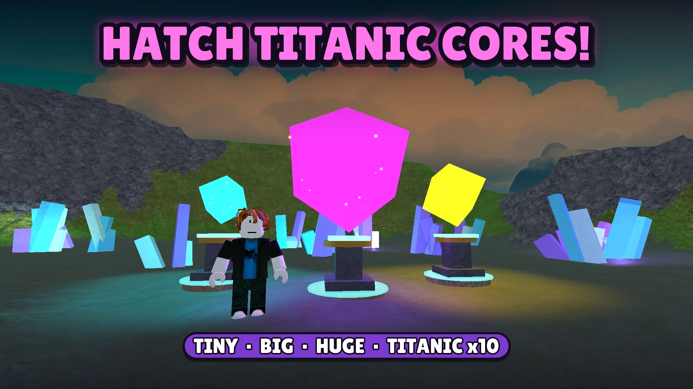
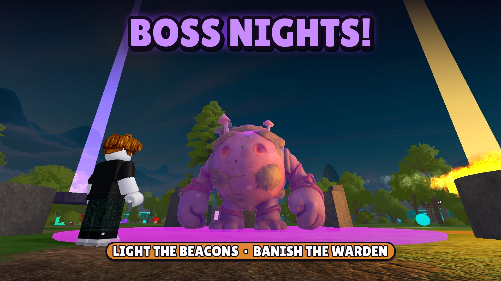
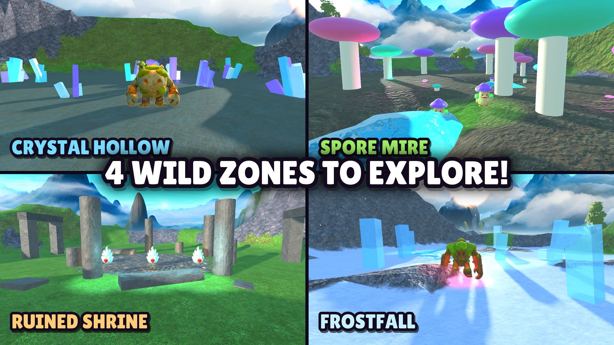

# Anomaly Grove: Grow & Steal Tycoon

A live multiplayer Roblox game: grow glowing cores on your plot, steal them from rival bases, and survive monster-filled nights.

**▶ Play it on Roblox:** https://www.roblox.com/games/88948987401653/Anomaly-Grove



| | |
|---|---|
|  |  |

## At a glance
- **~24,000 lines of Luau** across 142 modules, strict-typed (`--!strict`), linted with Selene, formatted with StyLua, type-checked with luau-lsp
- **240 automated tests** (37 spec files, custom test runner) covering economy math, save migration, session locking, security rules and game systems
- **Server-authoritative design:** every client request is validated (types, ranges, reach, cooldowns, ownership); a full security audit of all remote handlers is applied
- **Mobile-first UI**, built entirely in code (no hand-placed GUI), tested on phone-sized viewports
- **Rebuildable world:** maps, zones, hub, furniture and lighting come from idempotent builder modules, so the whole place can be regenerated from source

## Gameplay systems
- **Core loop:** harvest seeds → incubate on pedestals → cores earn cash every second; rarities, mutations (Gold / Void / Shocked / Celestial / limited Eclipse) and sizes (Tiny → Titanic)
- **PvP stealing:** server-timed rips, carry slowdown, tag-to-drop, steal alerts, base defenses (turrets, laser doors, trap tiles), Vault Lock
- **PvE nights:** five monster types with distinct AI (chasers, a lunging stalker, seed-stealing wisps, a telegraphed area-slam golem, a projectile spitter) plus a cooperative **boss night** where the server lights four beacons to banish the Grove Warden
- **Four wild zones** past the ring wall, each with its own seeds, Foraging gate and resident guardians leashed to the zone
- **Long-term progression:** 7 skills to level 99 on the RuneScape XP curve with perks and capes, rebirths with a skill tree, pedestal upgrades, crates, a 50-entry collection Index, a season pass, quests, daily rewards and milestones
- **Live-ops features:** rotating Traveling Market (same stock in every server, per-server scarcity), Fuse Machine, weather events (rain, thunderstorms, aurora), a weekly scheduled event, companions, codes and a group reward
- **Economy tuned by simulation:** `scripts/pacing_sim.py` models ~1,200 hours of play to balance prices, income and rebirth pacing

## Engineering highlights
- **Data safety:** schema-versioned profiles with migrations, `UpdateAsync` saves with retries, autosave + `BindToClose`, and **session locking** so a player hopping servers can never load stale data or be overwritten (`ServerScriptService/DataService.luau`)
- **Security:** server-timed actions instead of trusting client prompts, purchase verification with `UserOwnsGamePassAsync`, idempotent receipt processing, NaN/inf guards, race-condition fixes for async reward checks (`ServerStorage/Tests/SecuritySpec.luau`)
- **Policy compliance:** paid-random-item odds disclosure and a `PolicyService` gate for regions where paid odds modifiers are restricted; a right-to-erasure tool for data deletion requests
- **Performance:** one shared AI loop for all monsters, per-frame budget tracking (`PerfBudget`), distance-culled visuals
- **Localization:** UI built for automatic translation into 11 languages

## Project layout
```
ReplicatedStorage/Shared/   Config (all tunables), shared math (Perks, Progression, Zones, Fuse, Weekly), remotes, types
ServerScriptService/        Game systems: data, economy, cores, stealing, monsters, events, market, rewards...
ServerStorage/Builders/     Idempotent world builders (map, terrain, zones, hub, monsters, furniture, lighting)
ServerStorage/Tests/        TestKit + *Spec.luau test suites
StarterPlayerScripts/       Client controllers and UI built in code
scripts/                    check (format/lint/types), pacing simulator, thumbnail composer
docs/GDD.md                 Game design document
```

## Running the checks
Requires the tools in `rokit.toml` (StyLua, Selene, Rojo for the sourcemap, luau-lsp).
```
powershell -ExecutionPolicy Bypass -File scripts/check.ps1   # Windows
sh scripts/check.sh                                          # macOS / Linux
```
Tests run inside a Studio playtest: `require(game.ServerStorage.Tests.RunTests).run()`.

## Credits
Design and development: Anomaly Grove Studios. Monster meshes are original AI-generated models; other assets are listed in `docs/ASSETS.md`.
